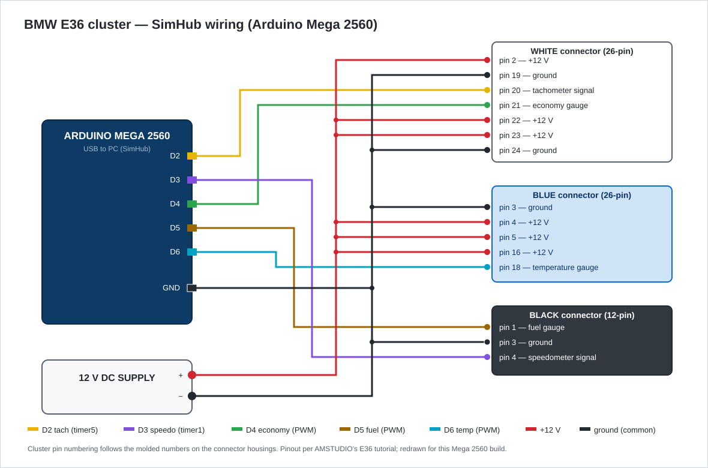

# BMW E36 Cluster as a SimHub Racing Dash

A real BMW E36 instrument cluster running as a live dashboard for sim racing — speedometer,
tachometer, fuel level, coolant temperature and the economy gauge all driven by an Arduino
Mega 2560 and [SimHub](https://www.simhubdash.com/).

The reason this repo exists: the classic community firmware for this mod **no longer works
with current SimHub versions**. SimHub 9.11 silently refuses to talk to it. This repo contains
a rebuilt firmware that speaks the modern SimHub protocol, plus the story of tracking that
problem down, because the diagnosis turned out to be more interesting than the wiring.

<!-- TODO: add photo/video of the cluster running here -->

## The problem

The well-known way to do this build is AMSTUDIO's E36 cluster tutorial and the matching
Arduino sketch (an old modified copy of SimHub's `DisplayClientV2`). The wiring from that
tutorial is fine and I used it. The sketch is not: it was written around 2019, and with a
2026 SimHub install the device never connects. No error, no popup — SimHub just scans the
port forever:

```
DEVICES SCAN
19:29:16  COM5                              Port not scanned (3 failures)
```

Meanwhile the Arduino was provably alive: opening COM5 manually at 19200 baud and sending
the 3-byte SimHub handshake (`0x03 '1' <trigger>`) got an instant answer. Hardware fine,
sketch running, SimHub still saying no. So the problem was somewhere in the conversation
between them.

## The diagnosis

1. **SimHub keeps a log.** `SimHub\Logs\SimHub.txt` said what the UI wouldn't:

   ```
   INFO - Arduino scan COM5 - Arduino Mega 2560 (0x0042, 0x2341), Unrecognized, Invalid version (1x)
   ```

   Not "no response" — *invalid version*. SimHub was hearing the board and rejecting it.

2. **The version is hidden in the handshake.** Reading both sketches side by side showed the
   trick: the byte a sketch sends back to SimHub's hello **is its protocol version**. The old
   community sketch answers `'h'`. SimHub 9.11's own bundled sketch answers `'j'`. Two protocol
   revisions apart, and SimHub hard-rejects anything that isn't current. There is no
   compatibility mode.

3. **Patching the old sketch was the wrong move.** Between revision `'h'` and `'j'` the whole
   transport changed — modern SimHub doesn't even speak raw serial anymore. It wraps every
   command in CRC8-checksummed, acknowledged packets (`ArqSerial`). Faking the version byte
   would just make the next layer fall apart. The right move was the opposite direction:
   take SimHub's **current** sketch and port the E36 cluster logic into it, using the
   `SHCustomProtocol.h` extension point that exists exactly for custom hardware.

4. **The port had a landmine in it.** The cluster needs two independent square-wave outputs
   (speedometer and tachometer are frequency-driven) plus three PWM channels (fuel, temp,
   economy). The obvious tools are the `Tone` and `NewTone` libraries — and they cannot both
   be linked into one binary (`multiple definition of __vector_17`: both define the same
   timer interrupt). Worse, on a Mega 2560 a second `Tone` instance allocates **timer3**,
   and timer3 is what generates PWM on pin 5 — the fuel gauge. The libraries would have
   silently killed a gauge.

5. **So the firmware generates the signals itself.** Two small CTC-mode generators, written
   directly against the AVR timer registers:

   | Timer | Drives | Why this timer |
   |---|---|---|
   | timer1 | speedometer square wave (D3) | its PWM pins (11/12) are unused here |
   | timer5 | tachometer square wave (D2) | its PWM pins (44–46) are unused here |
   | timer0 / timer3 / timer4 | untouched | they provide hardware PWM on D4 / D5 / D6 |

   Each generator picks its prescaler at runtime (÷64, falling back to ÷256 below ~2 Hz) so
   the speedo tracks correctly from walking pace to top speed.

6. **Verification without SimHub.** To prove the port before pointing SimHub at it, I framed
   a hello packet by hand — header, packet id, length, payload, CRC8 (the lookup table is in
   `ArqSerial.h`) — sent it over the port and got back the ack plus `'j'`. After that, SimHub
   connected on the first scan.

## How it works

```
game telemetry → SimHub custom protocol formula → USB serial (ARQ framed)
              → SHCustomProtocol::read() → timers + PWM → cluster gauges
```

SimHub sends one line per update: `gameRunning;speedKmh;fuelPercent;waterTemp;throttle`

| Gauge | Input | Output |
|---|---|---|
| Speedometer | 0–286 km/h | 0–367 Hz square wave on D3 |
| Tachometer | RPM (SimHub native gauge feature) | square wave on D2 |
| Fuel | 0–100 % | PWM 0–162 on D5 |
| Coolant temp | 40–120 °C | PWM 100–0 on D6 (gauge is inverted) |
| Economy (MPG) | throttle 0–100 % | PWM 255–0 on D4 (repurposed as throttle meter) |

The gauge scaling values are calibration from the original community sketch — that part of
their work carried over unchanged, because it was already right.

## Parts

Everything used in this build:

| Part | Used for | Link |
|---|---|---|
| ELEGOO Mega 2560 R3 (ATmega2560) | the brain — SimHub talks to it over USB | [amazon](https://www.amazon.com/dp/B01H4ZLZLQ) |
| 12 V 2 A DC power adapter | powers the cluster's gauges and lights | [amazon](https://www.amazon.com/dp/B01AZLA9XQ) |
| DC barrel jack screw-terminal adapters | clean tap from the 12 V adapter into the wiring | [amazon](https://www.amazon.com/dp/B0CR8TH2X2) |
| Dupont jumper wires, male–female | Arduino pins to the cluster connector pins | [amazon](https://www.amazon.com/dp/B07GD1R5MS) |
| TIP120 Darlington transistors (10 pack) | tachometer signal driver; the spares are reserved for the shift-light mod | [amazon](https://www.amazon.com/dp/B083TQN12B) |
| Heat shrink tubing kit | insulating the splices | [amazon](https://www.amazon.com/dp/B072PCQ2LW) |
| 80 W digital soldering iron kit | soldering the connector pins | [amazon](https://www.amazon.com/dp/B08R3515SF) |
| Precision tweezers set | seating pins in the connector housings, pulling cluster bulbs | [amazon](https://www.amazon.com/dp/B07SSXX8MT) |

Plus the E36 cluster itself, second-hand — eBay or a local breaker's yard.

## Wiring



The cluster exposes three connectors. Pin numbering follows the molded numbers on the
connector housings (the diagram matches AMSTUDIO's original pinout, redrawn for my
Mega 2560 build):

| Signal | Arduino Mega | Cluster pin |
|---|---|---|
| Tachometer | D2 | white connector, pin 20 |
| Speedometer | D3 | black connector, pin 4 |
| Economy gauge | D4 | white connector, pin 21 |
| Fuel gauge | D5 | black connector, pin 1 |
| Temp gauge | D6 | blue connector, pin 18 |
| +12 V supply | — | white 2, 22, 23 · blue 4, 5, 16 |
| Ground | GND | white 19, 24 · blue 3 · black 3 |

The 12 V supply ground and the Arduino ground must be common, or the gauges will read garbage.

## Flashing

The sketch is SimHub's `DisplayClientV2` (protocol revision `'j'`), so it compiles against
the libraries SimHub ships in `C:\Program Files (x86)\SimHub\_Addons\Arduino\Libraries`:

```bash
arduino-cli compile --fqbn arduino:avr:mega --libraries "C:\Program Files (x86)\SimHub\_Addons\Arduino\Libraries" firmware/DisplayClientV2
arduino-cli upload -p COM5 --fqbn arduino:avr:mega firmware/DisplayClientV2
```

(Arduino IDE works too — add the SimHub libraries to your sketchbook first.)

**Close SimHub before uploading.** It holds the COM port while scanning, and avrdude can't
open a busy port.

## SimHub setup

1. Arduino → My Hardware → **Single arduino**, enable your COM port.
2. Expand the device settings and set **Custom protocol** to the formula in
   [`docs/simhub-custom-protocol.txt`](docs/simhub-custom-protocol.txt), then Apply changes.
3. Tachometer range lives in the **Gauges** tab (it uses SimHub's native RPM output, not the
   custom protocol).
4. If the port shows `Port not scanned (3 failures)`, SimHub has blacklisted it until you
   toggle the port off/on or restart SimHub — it stops retrying after three failed scans.

A variant formula that shows **average tyre temperature** on the coolant gauge (nice for
ACC) is included in the same file — the cluster's 40–120 °C dial happens to map almost
perfectly onto GT3 tyre temps.

## Roadmap

- Turn signal bulbs as shift lights (needs one MOSFET driver board — the indicators are 12 V
  bulbs, not logic-level).
- Warning lights mapped to game states: ABS light on wheel lock, check-engine on engine
  damage, high-beam on DRS.
- Proper photos of the build.

## Credits

- **AMSTUDIO** — the original E36 cluster tutorial and connector pinout that started all of
  this ([video](https://youtu.be/L59NL9EuEdM)).
- **MorGuux** — the original E36 custom protocol sketch this firmware's gauge logic descends from.
- **Wotever / SimHub** — the base `DisplayClientV2` sketch and the whole telemetry platform.

The firmware here is SimHub's bundled sketch with the E36 cluster port in
`SHCustomProtocol.h` and a rewritten `SHTonePin.h`; those two files are where this project's
own code lives.
